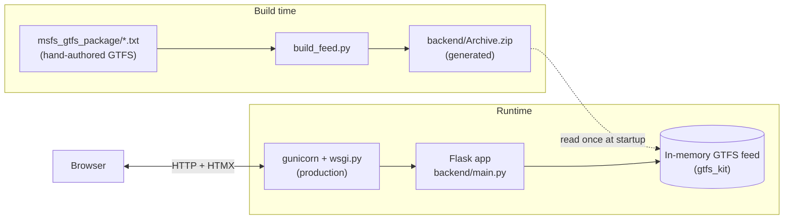

# Architecture

## Topology

The system is a **monolith**: one Flask process serves all pages from an in-memory copy of
the GTFS feed. There is no database and no external service called at request time.



## Components and responsibilities

| Component | File(s) | Responsibility |
|---|---|---|
| **GTFS source** | `msfs_gtfs_package/*.txt` | The hand-authored schedule data (the source of truth, version-controlled). |
| **Feed builder** | `build_feed.py` | Zips the source files into `backend/Archive.zip` at the archive root so `gtfs_kit` can read them. |
| **Generated feed** | `backend/Archive.zip` | Build artifact (git-ignored) the app loads at startup. |
| **Config** | `backend/config.py` | Environment flag (`DEV_MODE`), feed path, route/stop IDs and names. |
| **Web app** | `backend/main.py` | Loads the feed, wraps it in a small domain model, builds template context, and serves the three routes. |
| **Domain model** | `backend/main.py` (`Route`/`Trip`/`Stop`/`StopTime`) | Adapts `gtfs_kit`'s pandas DataFrames into plain objects/dicts the templates consume. |
| **Templates** | `backend/templates/*.html` | Server-side rendering (Jinja) + HTMX directives. |
| **Styles** | `backend/static/style.css` | The visual design system. |
| **WSGI entrypoint** | `backend/wsgi.py` | Exposes `app` for gunicorn in production. |

See [Backend](backend.md) and [Frontend](frontend.md) for how each side works internally.

## The feed build pipeline

GTFS feeds are normally distributed as ZIP files by transit agencies. The Maine State Ferry
Service does not publish one, so this repo treats `msfs_gtfs_package/` (individual `.txt`
files) as the editable source of truth and generates the ZIP on demand:

```
edit msfs_gtfs_package/*.txt  →  python build_feed.py  →  backend/Archive.zip  →  restart app
```

`build_feed.py` writes each file by **bare name** (no folder prefix) because
`gtfs_kit.read_feed` expects the GTFS files at the root of the archive.

## Why it's built this way

- **Monolithic SSR, not an SPA.** The dataset is tiny, read-only, and changes rarely. A
  server-rendered Flask app is the simplest thing that works — no API layer, no client build
  step, no state synchronization. (An earlier React SPA was removed in favor of this.)
- **HTMX for live updates.** The home page needs to refresh "next departure" / "in progress"
  over time. HTMX polls a fragment every 60s and swaps the HTML, giving live behavior without
  shipping a JavaScript application or a JSON API.
- **Feed held in memory.** The feed is small and immutable for the life of the process, so it
  is read once at startup rather than queried from a database. This keeps deployment to a
  single process with no datastore.
- **Generated ZIP, tracked source.** Keeping the editable `.txt` files in version control
  (and the ZIP git-ignored) makes schedule edits reviewable as diffs, while the app still
  consumes the standard GTFS ZIP format.
- **Env-gated dev tooling.** The time-override debugging tools are gated on a dedicated
  `DEV_MODE` flag (from `MSFSGTFS_ENV`) rather than Flask's `DEBUG`, because `flask run`
  manipulates `DEBUG` independently. This keeps "are dev tools on?" controlled solely by
  configuration. See [Backend](backend.md#dev-only-time-override).
